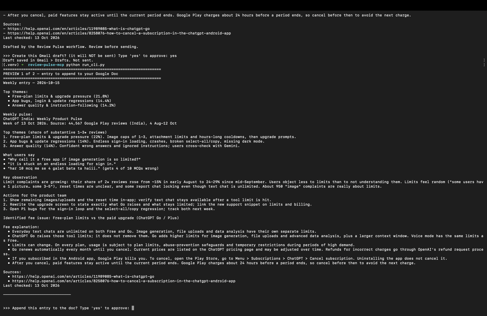
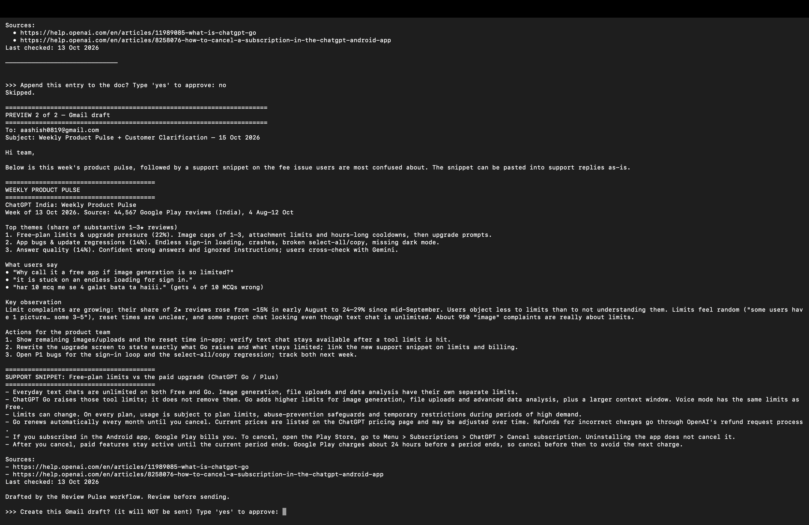
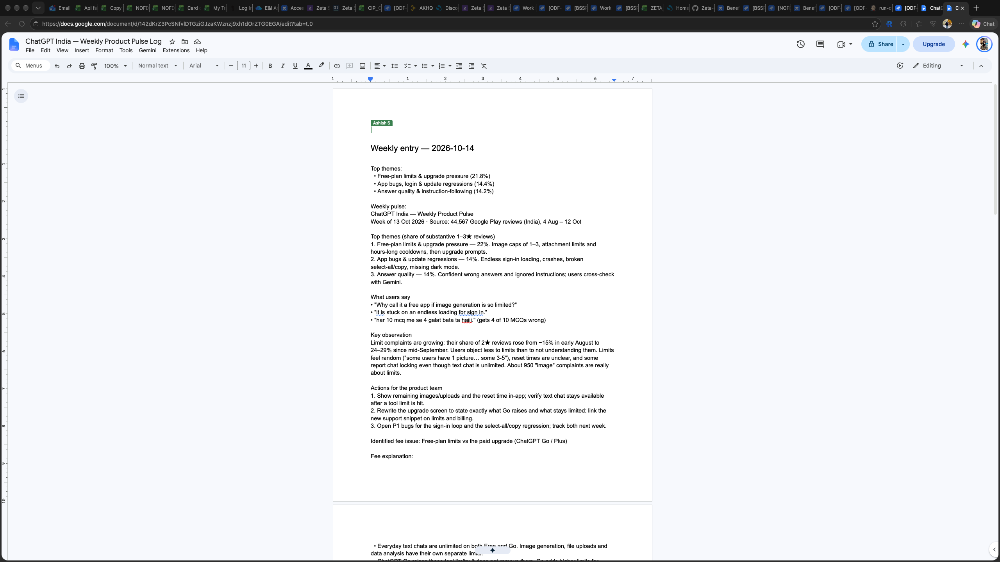
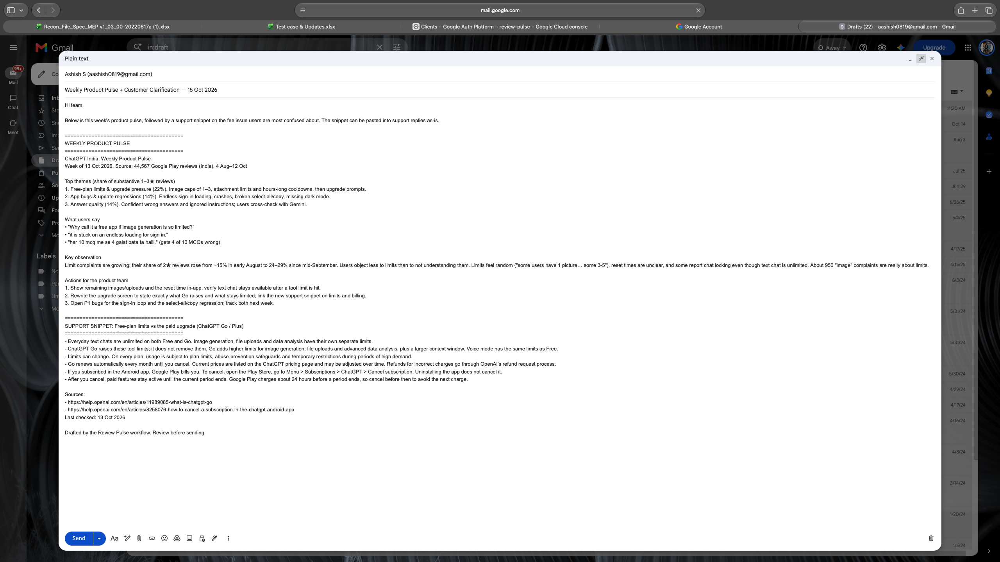

# Review Pulse — ChatGPT India (Milestone 5: RAGs & Context Engineering)


An AI workflow that turns raw Google Play reviews of the ChatGPT Android app (India) into:
1. a **weekly internal product pulse**, and
2. a **customer-facing explainer** for the fee/plan issue users are most confused about.

An MCP server built for this project then logs both into a Google Doc and creates a Gmail draft. **Each write needs explicit user approval.** Nothing is sent automatically.

Product: ChatGPT India mobile app (the same product as Milestones 1–3).

---

## Pipeline

```
Google Play reviews ──► fetch_reviews.py ──► reviews_sample.csv (515 reviews, 10 weeks)
                                                    │
                    Step 1  Review intelligence (LLM, step1_prompt.md)
                            + sizing across all 12,257 complaints (size_themes.py)
                                                    │
                                          step1_insights.json
                                     ┌──────────────┴──────────────┐
           Step 2  Weekly pulse (≤250 words)      Step 3  Fee explainer (≤6 bullets)
                   weekly_pulse.md                        grounded in 2 official
                                                          OpenAI Help Center pages (RAG)
                                     └──────────────┬──────────────┘
                     MCP server "review-pulse" (server.py)
                        get_weekly_outputs   (read-only)
                        append_to_doc        (write → USER APPROVAL)
                        create_email_draft   (write → USER APPROVAL, never sends)
                                                    │
                         Google Doc entry  +  Gmail draft  +  approval_log.csv
```

## How to run

**1. Collect reviews** (optional; the CSV is included)
```
pip install google-play-scraper
python fetch_reviews.py            # writes reviews_raw.csv and reviews_sample.csv
```

**2. Steps 1–3: analysis and writing.** The system prompt in `step1_prompt.md` plus `reviews_sample.csv` produce `step1_insights.json`. The pulse and explainer are written from that JSON and saved as `weekly_pulse.md` and `fee_explainer.md`. `size_themes.py` checks the LLM's themes against the full dataset.

**3. MCP actions.** Full click-by-click instructions are in `SETUP.md`.
```
python3 -m venv .venv && source .venv/bin/activate
pip install -r requirements.txt
cp config.example.json config.json   # then set draft_to to your email
python auth_setup.py               # one-time Google sign-in; creates the log doc
python run_cli.py                  # run with typed approval, OR:
```
connect `server.py` to the Claude desktop app (`SETUP.md` step 4) and ask:
> Use review-pulse to load this week's outputs, show me a short preview, then log them to the doc and create the email draft.

## Where MCP approval happens

| Layer | What the user sees | What it prevents |
|---|---|---|
| **MCP client (Claude app)** | Before each tool call: the tool name and the exact values it will send, with **Allow / Deny**. The write tools are marked non-read-only. Use "Allow once" so every write is approved fresh. | Any doc or email write without a human decision |
| **CLI fallback** (`run_cli.py`) | A full preview of the doc entry, then of the email, and each requires typing `yes` | Same, without an AI client |
| **Built into the code** | The server has no function that sends email. Its Google permissions are limited to editing Docs and composing Gmail drafts, so it cannot read the inbox. | Auto-send, even if a tool call goes wrong |
| **Audit trail** | `approval_log.csv` records every approved, rejected or failed write with a timestamp | Unlogged actions |

## Automated checks against the brief

`test_deliverables.py` runs on every push (GitHub Actions, badge above) and locally with `pytest`. It checks:

- **Step 1:** at most 5 themes, top 3 picked, and all 3 quotes appear word for word in the review they cite.
- **Step 2:** the pulse is 250 words or fewer, has all required sections, and has exactly 3 action ideas.
- **Step 3:** the explainer has 6 bullets or fewer, 2 official https sources, and a "Last checked" date.
- **MCP actions:** the doc entry has every field the brief lists, and the email subject matches the brief.
- **Safety:** no code path can send email, and the Gmail permission is compose-only.

No Google account is needed to run the tests.

## Fee issue identified from reviews

**Free-plan limits vs the paid upgrade (ChatGPT Go / Plus).**

- **Size:** 21.8% of substantive 1–3★ complaints (2,674 of 12,257), the largest theme.
- **Growth:** its share of 2★ reviews rose from about 15% in early August to 24–29% since mid-September.
- **What it's about:** 43% hit an image, attachment or chat cap followed by a cooldown. 32% feel pushed to upgrade ("why call it a free app?"). The rest cover paid-but-still-limited, billing (plan not activated, charged, cancelling), and limits that seem inconsistent between users. 73 reviews name ChatGPT Go explicitly.
- **What users ask:**
  - What is free?
  - Why do I get 1 image when others get 3–5?
  - Can I still chat after hitting a limit?
  - What does Go change?
  - How do I cancel?

The fee explainer answers each of these, using only official OpenAI Help Center content. It leaves out prices on purpose: OpenAI's page doesn't list an India price and says prices may change, so a stated price would quickly go out of date.

## Top themes (10 weeks, 4 Aug–12 Oct 2026)

| Theme | Share |
|---|---|
| Free-plan limits & upgrade pressure | 21.8% |
| App bugs, login & update regressions | 14.4% |
| Answer quality & instruction-following | 14.2% |
| Image quality & content-policy blocks | 14.0% |
| Trust, privacy & ethics | 3.5% |

## Data notes and limitations

- **Source:** 44,567 Google Play reviews (India store), 4 Aug–12 Oct 2026. Usernames and avatars were dropped at collection.
- **Sampling:** the LLM sample is 515 reviews, about 45 complaints and 10 positive reviews per week. Every week counts equally, so the sample is designed to find problems, not to measure overall sentiment.
- **Coverage gaps:** fetch caps mean 1★ reviews start on 10 Sep and 3★ on 25 Aug. Weekly trends use 2★ reviews only (full 10-week coverage), so weeks are compared like for like.
- **Excluded from shares:** two-thirds of complaints are 4 words or fewer and are left out of theme shares. Of the remaining reviews, 45% could not be tagged to any theme (vague, or in non-Latin scripts).
- **Ranking:** themes 2–4 are within 0.4 points of each other. Theme 2 (bugs) is ranked above image quality because the app team can act on it immediately.
- **Quotes:** every quote is copied verbatim and traceable by `review_id` in `step1_insights.json`.

## Repository

| File | Purpose |
|---|---|
| `server.py` | The MCP server (works with MCP Python SDK v1 and v2) |
| `google_tools.py` | Google Docs append and Gmail draft. The only code that touches Google. |
| `core.py` | Builds the doc entry and email from the output files; writes the approval log |
| `run_cli.py` | Same workflow with typed approval |
| `auth_setup.py` | One-time sign-in; creates the log doc |
| `step1_insights.json` | Step 1 output: themes, quotes and fee issue, with review IDs |
| `weekly_pulse.md` | Step 2 output: the weekly product pulse |
| `fee_explainer.md` | Step 3 output: the fee explainer / support snippet |
| `fetch_reviews.py` | Collects the reviews from Google Play |
| `step1_prompt.md` | Step 1 system prompt |
| `size_themes.py` | Checks theme sizes across the full dataset |
| `reviews_sample.csv` | The 515-review sample used for Step 1 |
| `approval_log.csv` | Evidence: every approved, rejected or failed write |
| `test_deliverables.py` | Automated checks against the brief |
| `SETUP.md` | Setup and demo script |
| `config.example.json` | Copy to `config.json`. `credentials.json`, `token.json` and `config.json` are git-ignored and never committed. |

## Screenshots

| | |
|---|---|
| Approval step (nothing written yet) |  |
| Rejected: user typed `no`, nothing was written |  |
| Entry appended to the Google Doc |  |
| Gmail draft, saved and not sent |  |

## Sources
See `sources.md`.
